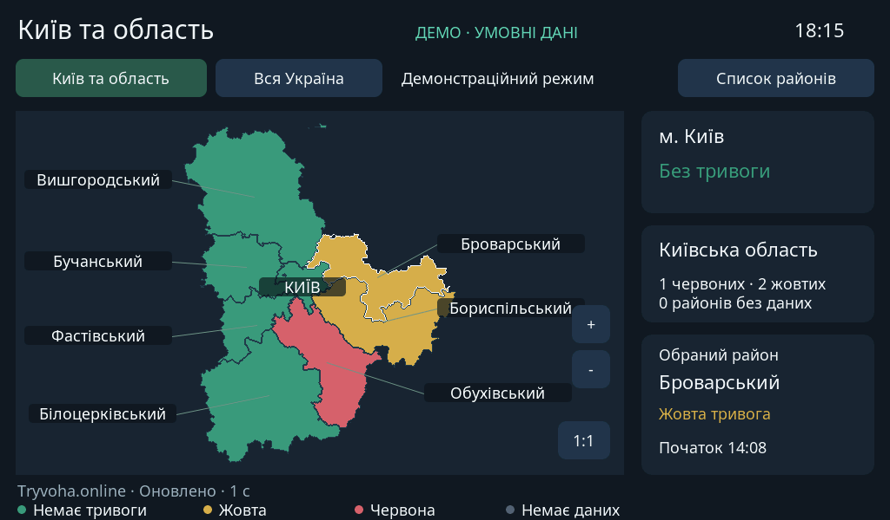
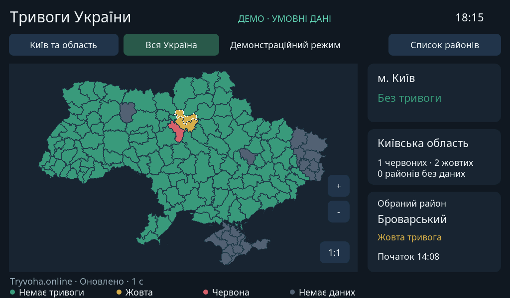
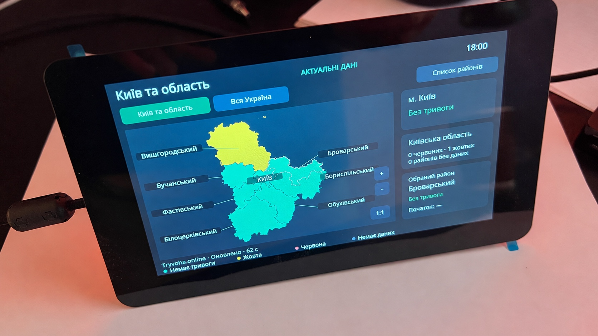
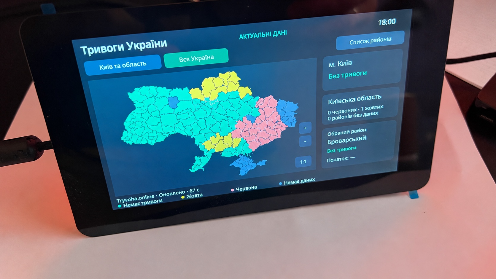

# Ukraine Alerts: Kyiv and Kyiv Oblast

**[Download firmware v0.1.0 (ZIP)](https://github.com/shaposhnikoff/ESP32_S3_Alerts_map/releases/download/v0.1.0/ukraine-alerts-esp32s3-v0.1.0.zip)**

# THANK YOU, TRYVOHA.ONLINE!

**THIS APPLICATION USES FREE ALERT DATA PROVIDED BY [TRYVOHA.ONLINE](https://tryvoha.online/). THANK YOU FOR MAKING THIS SERVICE AVAILABLE.**

The primary data source is Tryvoha.online. The application credits the service on
screen and here, as required by its [API terms](https://tryvoha.online/api).
UA Siren is a reserve source. Both share UkraineAlarm as an underlying alert
source, so the reserve is not an independent warning system.

A native LVGL application for **[Waveshare ESP32-S3-Touch-LCD-7B](https://www.waveshare.com/wiki/ESP32-S3-Touch-LCD-7B)**,
with a desktop simulator that runs the same interface and alert model.

## Screenshots

The desktop simulator rendered both 1024 × 600 screens using fictional demo data.

### Kyiv city and Kyiv oblast



### Ukraine district map



### On the Waveshare display

These photos show the interface running on the ESP32-S3-Touch-LCD-7B. The
background handwriting and a connection error were removed from the images.





## Interface

- Startup opens **Kyiv city and Kyiv oblast**, with seven independent districts.
- Kyiv city has its own status and does not inherit Kyiv oblast's alert.
- The second tab displays Ukraine's district map.
- Red/yellow: source-reported alert level. Green: no applicable alert reported
  in fresh supported data. Gray: unavailable or unsupported coverage.
- Subordinate community alerts show partial coverage of their actual district.
- Tap a district, use the district list, pan, zoom, or return to the original view.
- Lost connectivity keeps the last known state and shows a stale banner.
- No drones, flight paths, or estimated threat positions.
- **No configuration screen.** Configuration is supplied at build time.

## Optional buzzer

Connect an active-high 3.3 V buzzer module to J8 using GP6 for control, 3V3 for
power and GND for ground. A newly affected zone in Kyiv city or Kyiv oblast
triggers one 180 ms pulse. Simultaneous starts share one pulse. The first known
status sets the baseline silently. Repeated updates and severity changes leave
the buzzer silent. See the [J8 connection guide](docs/hardware-compatibility.md#external-buzzer).

## Build-time configuration

Start from `config/alerts.example.json`. Create `config/local.json` locally and
fill in Wi-Fi credentials there. That path is ignored by Git.

Pass the configuration using an absolute path:

```bash
idf.py -DALERTS_CONFIG_FILE="$PWD/config/local.json" -B build-firmware build
```

Configuration includes Wi-Fi, public HTTPS provider URLs, refresh/stale/timeout
intervals, timezone rules, brightness, demo mode, and an optional OTA URL.
Neither provider needs an API key. Polling defaults to once per 60 seconds.

**Never publish `config/local.json`, generated build directories, or a firmware
image containing personal credentials.** The credentials become part of that
private firmware image. Flash encryption/secure boot are not enabled by default.
Do not put real credentials into `config/alerts.example.json` or CI.

`config/demo.json` builds an explicitly labeled demonstration with fictional
statuses and no API requests. Demo data is never used as a silent network fallback.

## Firmware build

Requirements: ESP-IDF **5.5.2**, its ESP32-S3 toolchain, CMake and Ninja.
Activate that IDF environment first.

```bash
idf.py -B build-firmware build
```

The default example config deliberately contains no Wi-Fi credentials. The
firmware displays that configuration is missing instead of inventing live data.
Use your private configuration for actual monitoring.

The firmware image is `build-firmware/ukraine_alerts.bin`. The generated
`build-firmware/flash_args` includes the bootloader and partition table.
Use the exact **7B** touch board, not a 5-inch or 800 x 480 variant.

Flashing, after confirming the correct serial port and configuration:

```bash
idf.py -B build-firmware -p /dev/your-serial-port flash monitor
```

Do not run `erase-flash` as routine troubleshooting. See
[hardware compatibility](docs/hardware-compatibility.md) for UART selection and
the status of physical verification.

## Download a public firmware build

Sign in to GitHub, open a successful `main` run of [Build and test](https://github.com/shaposhnikoff/ESP32_S3_Alerts_map/actions/workflows/ci.yml),
and download `ukraine-alerts-esp32s3-<commit>` from **Artifacts**. The archive
contains the application, bootloader, partition table, initial OTA data, flash
arguments, SHA-256 checksums and flashing instructions.

The public image has no Wi-Fi credentials or OTA endpoint. It can boot and
display the interface. For live monitoring, build a private image using
[build-time configuration](#build-time-configuration).

## Desktop simulator

Requirements: CMake 3.24+, a C++17 compiler, SDL2, and libcurl.

```bash
cmake -S simulator -B build-sim
cmake --build build-sim --parallel
ctest --test-dir build-sim --output-on-failure
./build-sim/alerts_simulator
```

The simulator uses live free API data by default. To build the demo explicitly:

```bash
cmake -S simulator -B build-demo \
  -DALERTS_CONFIG_FILE="$PWD/config/demo.json"
cmake --build build-demo --parallel
./build-demo/alerts_simulator
```

Capture both demo screens:

```bash
./build-demo/alerts_simulator --capture build-demo/kyiv.bmp
./build-demo/alerts_simulator --country --capture build-demo/ukraine.bmp
```

The UI is the same C++/LVGL implementation as the firmware, not an HTML recreation.

## Tests and map assets

```bash
cmake -S tests -B build-core
cmake --build build-core --parallel
ctest --test-dir build-core --output-on-failure

cd tools/map
bun install --frozen-lockfile
bun run check
```

Generated map assets and Cyrillic fonts are included so an ordinary firmware
build does not need Bun or access to live alert services.

To regenerate assets intentionally:

```bash
cd tools/map
bun run generate
```

See [map data](docs/map-data.md) for the pinned geographic source, provenance,
district mapping, and licensing.

## Behavior and limitations

- [Data flow and navigation](docs/diagrams/alerts-data-flow.md)
- [Hardware compatibility](docs/hardware-compatibility.md)
- [Validation evidence](docs/test-results.md)
- [API contract](docs/api-contract.md)

This is an informational display. Provider data can be delayed; green means no
alert reported by the selected source, not a safety guarantee. Follow official
alert channels for personal safety.

## Licenses and attribution

Application source: MIT, see `LICENSE`.

District boundaries: State Scientific Production Enterprise Kartographia /
OCHA HDX, distributed by geoBoundaries under **CC BY 3.0 IGO**.
See `assets/map/source-manifest.json` and `docs/map-data.md`.

Noto Sans: Google/Noto contributors, **SIL Open Font License 1.1**,
see `assets/fonts/OFL.txt`. LVGL, cJSON, ESP-IDF and the Espressif display/touch
components retain their respective upstream licenses.
