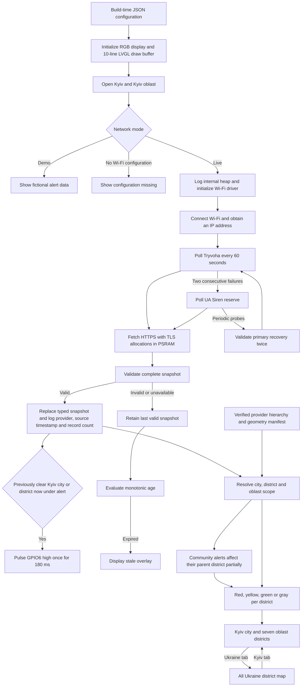

# Alert data flow

Kyiv city has no parent oblast in the model, so an oblast-wide alert cannot
implicitly change the city's independent status. The reserve provider only
confirms positively mapped active alerts; omission remains unknown until a
complete inactive-region contract is established.

The first known status of a zone establishes its baseline silently. Unknown
updates retain the last known zone status. Repeated active statuses and changes
in alert severity do not trigger a new pulse.
